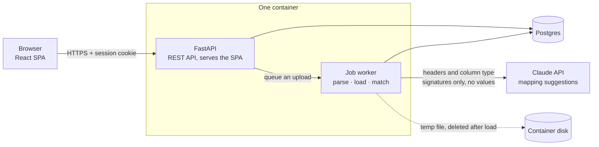
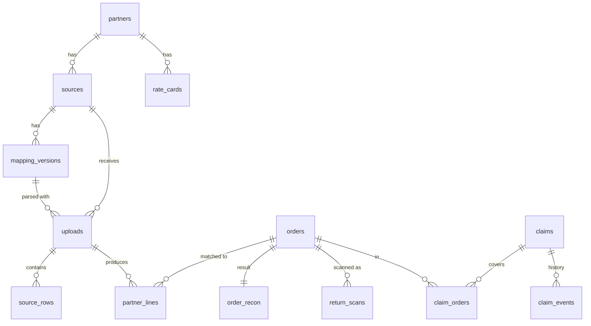

# Settle: Technical Design Document

**GitHub:** https://github.com/diptanu2004/IsoCode-Takehome
**Live app:** `TODO: deployed URL`
**Demo accounts:** listed in [deployment.md](../deployment.md)

**Status:** Draft v0.1, 2026-11-02. Sections marked **TBD** are filled in as the
build lands. This file is the source; the submitted PDF is exported from it.

Conventions used throughout:

- **[A n]** marks an assumption. Every assumption is listed in
  [§14](#14-assumptions-register) with its reason and how it could change.
- Money is in rupees. 1 lakh = 1,00,000; 1 crore = 1,00,00,000.
- *Difference = Received − Expected.* Negative means Company A got less than it
  should have, matching the sign used in the brief's sample data.
- The client brief is in [brief.md](brief.md).

---

## 1. Summary

Company A loses about ₹64.8 lakh a year through partner payment errors:
unremitted cash on delivery (COD), wrong fees, wrong weight slabs and lost
returns. It also spends ₹10.8 lakh a year of finance time matching partner
reports in Excel. Month-end close takes 12 days.

Settle takes every partner's report files and works out what each order
should have paid, using versioned rate cards. It compares that with what was
actually paid, and turns every gap into a claim with evidence attached.
Statutory deductions (GST TCS and income tax TDS) are shown separately and
never counted as leakage. When a partner changes its file format, AI suggests
the new column mapping. A person checks it on a 20-row preview and approves it,
and every version can be rolled back.

Headline results (**TBD**, measured on the deployed build):

| Measure | Target | Result |
|---|---|---|
| 1 lakh-row file, upload to finished matching | < 60 s | TBD |
| Orders auto-matched on seed data | ≥ 98% | TBD |
| AI mapping accuracy on the changed-format test set | TBD | TBD |

## 2. Problem and goals

### 2.1 How it works today

- **Sales channels.** Orders come from the website, 3 marketplaces and 2
  quick-commerce apps.
- **Couriers.** Website orders ship through 2 courier aggregators, and 55% of
  website orders are COD.
- **Reconciliation.** Every month, finance downloads settlement, COD remittance
  and freight invoice reports and matches them in Excel with lookups.
- **Returns.** These are rarely checked against what reached the warehouse.
- **Books.** These are kept in Tally.

### 2.2 What it costs (from the brief)

| Item | Working | Per year |
|---|---|---|
| Leakage | 30,000 orders × ₹1,200 × 12 = ₹43.2 cr; 1.5% leaks | ₹64.8 L |
| Reconciliation time | 3 people × 60% × ₹6 L | ₹10.8 L |
| **Total** | | **₹75.6 L** |

This gives the scale the product has to handle. Leakage runs at about ₹5.4 L a
month. At 98% auto-matching, about 600 orders a month still need a person to
look at them, so the exception screens are designed for hundreds of rows, not
thousands. The ₹6.5 L budget is less than the cost of one month of the problem.

### 2.3 Success measures

| Measure | Target | What in the product moves it | How it is shown |
|---|---|---|---|
| Orders auto-matched | 98% | ID normalisation, matching on order ID or AWB (courier tracking number), a review queue for the rest | Overview KPI ([A1] defines the rate) |
| Month-end close | 12 → 3 days | Files are uploaded through the month, not at month end; matching re-runs only for affected orders; people work only the exceptions | Argued in this document; a demo cannot measure it |
| Recovered through claims | ≥ ₹30 L in year one | Claims carry their evidence; small one-directional gaps are rolled up into a single claim (§8.5); claims are aged | Recovered vs target on the Overview |

## 3. Scope

The brief's core build is file upload with saved column mapping, order-level
matching, rate-card expected amounts, a claims list and a money-at-risk view.
It also asks for two roles, AI column mapping, and 1 lakh rows matched in under
a minute.

| Tier | What is included |
|---|---|
| **Core**: works end to end | <ul><li>Sign-in with two roles</li><li>Upload of CSV or Excel files for five file kinds: orders, settlement, COD remittance, freight invoice, warehouse return scans</li><li>Column mapping saved per source: rules plus AI suggestions, 20-row preview, approval, versions, rollback</li><li>Rate cards with effective dates</li><li>Order-level matching with all five statuses from the brief, with TCS and TDS kept separate</li><li>Claims list with evidence export</li><li>Money-at-risk view by partner and age</li></ul> |
| **Depth**: low cost, planned | <ul><li>TCS/TDS summary per partner</li><li>Extra statuses: *pending* (not yet due), *within tolerance*, *overpaid*</li><li>Detection of systematic small gaps (§8.5)</li><li>Claim lifecycle, with recovered money tracked against the ₹30 L target</li><li>Claims close automatically when a late payment arrives</li><li>Audit log</li></ul> |
| **Stretch**: if time allows | <ul><li>Review queue of suggested matches for partner rows that have no order ID</li><li>Separate returns-tracker screen</li><li>Returns-manager role</li></ul> |
| **Mocked** | Sending a claim to a partner: the app marks it raised and produces the evidence pack; nothing is sent |
| **Out of scope** | Storefront or inventory sync, GST filing, automatic claim filing (all from the brief); payment-gateway reconciliation [A2]; live partner integrations |

"Return not received" is one of the core statuses, so warehouse scan files are
part of the core upload pipeline. Only the separate tracker *screen* is a
stretch item.

## 4. Users and roles

The brief names two roles for the core build. The **finance executive** does
the daily work: uploads, matching and claims. The **co-founder** has every
permission the executive has. On top of that, the co-founder controls the
settings that decide what counts as money owed, and the actions that give
money up.

| Action | Finance executive | Co-founder |
|---|:---:|:---:|
| Upload files | ✓ | ✓ |
| Approve or roll back a column mapping | ✓ | ✓ |
| Void an upload (removes its rows and re-runs matching) | Own uploads | Any |
| View orders, statuses and the expected-vs-actual breakdown | ✓ | ✓ |
| Accept or reject suggested matches | ✓ | ✓ |
| Raise a claim, add the partner's reference, mark it recovered or partner-rejected | ✓ | ✓ |
| Export evidence | ✓ | ✓ |
| **Write off a claim** | — | ✓ |
| View rate cards | ✓ | ✓ |
| **Create or edit rate cards** | — | ✓ |
| **Edit tolerance, settlement cycles, return window** | — | ✓ |
| Money-at-risk overview | ✓ | ✓ (home screen) |
| **Invite or deactivate users, change roles** | — | ✓ |
| View audit log | Own actions | All |

Why the split falls where it does:

- **Rate cards are co-founder only.** The rate card defines the expected
  amount, so anyone who can edit it can make a shortfall disappear. The
  co-founder also signs the partner contracts and knows the agreed rates.
- **Write-off is co-founder only.** It is the one action that turns money at
  risk into an accepted loss. Limiting it also stops the queue being cleared
  by closing claims, which would make the recovery figures look better than
  they are.
- **A partner's rejection does not close a claim.** It stays in money at risk
  until the money is recovered, the claim is raised again, or the co-founder
  writes it off.
- **Executives approve mappings themselves.** Partners change formats without
  notice. Waiting for the co-founder every time would slow month-end, which
  works against the 3-day close target. The safeguards are the 20-row preview,
  versioning with rollback, and the audit log.
- **No role can see personal data.** Customer names, phone numbers and
  addresses are never stored (§12.2), so there is no "reveal" permission to
  manage.

**How it is enforced.**

- One permission map in code, from each role to its set of permissions.
- Every API route checks that map on the server. Hiding a button does not
  count as access control.
- The frontend reads the signed-in user's permissions from `/api/me` and hides
  actions the user cannot take, so there are no dead buttons. Executives see
  rate cards in read-only form.
- A test is generated from the same map. It calls every protected route as
  each role and checks for 200 or 403.

## 5. Architecture



### 5.1 Components

- **Frontend.** React and TypeScript, built with Vite, using:
  - TanStack Query for server data and TanStack Table for the large tables;
  - React Router;
  - Tailwind CSS with a small set of design tokens (§11).
- **API.** FastAPI with Pydantic models for every request and response.
  Database access uses SQLAlchemy Core, with psycopg 3 for `COPY`. Schema
  changes go through Alembic migrations.
- **Job worker.** A background thread inside the API process. It takes queued
  uploads from Postgres using `SELECT … FOR UPDATE SKIP LOCKED` and runs one
  job at a time, so two recomputes can never overlap. If a job has been stuck
  in a running state for too long, it is re-queued when the process starts.
  There is no Redis and no separate queue to deploy.
- **File parsing.** Polars reads CSV, and the calamine engine reads Excel.
  Normalisation runs on whole columns at once.
- **Matching.** Set-based SQL that runs inside Postgres (§8, §10).
- **AI.** The Anthropic Python SDK calls Claude for mapping suggestions (§9).
  The app works without an API key; suggestions then come from rules only.

### 5.2 Choices and alternatives

| Decision | Choice | Why | Rejected alternative |
|---|---|---|---|
| Backend language | Python and FastAPI | Polars parses a 1 lakh-row CSV or Excel file in seconds; Pydantic validates every input; pytest for the matching rules | Node.js: Excel parsing is slower and uses more memory at this size |
| Where matching runs | SQL in Postgres | Joins and group-bys over 1 lakh rows take seconds in the database. Looping over rows in app code is where time budgets are lost | Matching row by row in Python |
| Background work | Worker thread with a Postgres-backed queue | Long jobs never run inside an HTTP request, and nothing extra has to be deployed | Celery with Redis: more moving parts than one company's volume needs |
| Deployment | One Docker container serving the API and the built SPA, plus managed Postgres | One URL, no cross-origin or cookie problems, one thing to deploy | Serverless functions: request-size limits and timeouts do not fit 1 lakh-row files |
| Money type | Integer paise in `bigint` columns | No floating-point drift in sums or comparisons | `numeric`/`float` columns |

## 6. Data model



| Table | Key columns | Notes |
|---|---|---|
| `users` | email, password_hash, role, is_active | Role is `exec` or `cofounder` |
| `sessions` | token_hash, user_id, expires_at | Server-side sessions, so deactivating a user takes effect at once |
| `partners` | name, kind, settlement_cycle_days, tolerance_paise, return_window_days | Kind is marketplace, quick-commerce, courier, warehouse or storefront |
| `sources` | partner_id, file_kind | For example "Marketplace 1 · settlement". Each saved mapping belongs to a source |
| `mapping_versions` | source_id, version, header_fingerprint, mapping (jsonb), personal_data_columns, suggested_by, approved_by, is_active | Never edited in place; rollback makes an older version active again |
| `uploads` | source_id, mapping_version_id, filename, sha256, row_count, error_count, status, stage_timings | Also acts as the job queue. Status runs queued → needs_mapping → loading → matching → done, or ends in failed or voided |
| `source_rows` | upload_id, row_no, raw (jsonb), error | The original cells, **minus personal-data columns**. Used as evidence and to re-apply a mapping after rollback |
| `orders` | order_id, channel_partner_id, courier_partner_id, awb, order_date, value_paise, units, payment_mode, declared_weight_g, delivery_status, delivered_at, returned_at | One row per order. A later upload updates the status. No name, phone or address |
| `partner_lines` | upload_id, row_no, partner_id, order_ref, awb, order_id (once resolved), component, amount_paise, txn_date, reference | One row per money component per order (§8.1) |
| `return_scans` | upload_id, row_no, awb, order_ref, scanned_at, condition | Warehouse receipt scans |
| `rate_cards` | partner_id, version, effective_from, effective_to, rules (jsonb) | Matching uses the version in force on the order date |
| `order_recon` | order_id, expected_paise, received_paise, diff_paise, tcs_paise, tds_paise, status, issues[], due_date, breakdown (jsonb), rate_card_id | The matching result. The breakdown holds expected vs actual for each component |
| `claims` | partner_id, type, amount_paise, status, recovered_paise, partner_ref, opened_at | Status runs open → raised → partner_rejected, then ends as recovered, written_off or auto_resolved |
| `claim_orders` | claim_id, order_id, amount_paise | One row for an ordinary claim; many for a systematic-gap claim |
| `claim_events` | claim_id, actor_id, from_status, to_status, note, at | Claim history |
| `match_suggestions` | partner_line_id, candidate_order_id, score, reasons, status | Stretch: the review queue for rows with no order ID |
| `audit_log` | actor_id, action, entity, entity_id, before, after, at | Every mapping approval, rate-card edit, claim change and role change |

Rules that apply across the model:

- **Every number can be traced.** Every partner line keeps its `upload_id` and
  `row_no`, so a claim can always show the file, the row and the original
  cells it came from.
- **Uploads are idempotent.** A file whose sha256 has been seen before is
  rejected. Rows are upserted on their natural key, so uploading an
  overlapping export does not double-count.
- **Indexes:**
  - `orders(order_id)` is unique; `orders(awb)`;
  - `partner_lines(order_id)`, `partner_lines(awb)`, `partner_lines(upload_id)`;
  - `order_recon(status)`;
  - `claims(partner_id, status)`.

## 7. Main flows

### 7.1 Upload and map a file

1. The user picks a source (for example "Courier A · COD remittance") and drops
   in a CSV or XLSX file. The API checks its type and size, saves it to a
   temporary file, records its sha256 and queues the upload.
2. The worker reads only the top of the file. It finds the header row
   (skipping title rows), takes a fingerprint of the headers, and checks for
   personal-data columns.
3. If the fingerprint matches the source's active mapping version, the worker
   moves straight on to step 5.
4. If it does not match, the partner has changed its format. The worker builds
   a suggestion (§9) and sets the upload to `needs_mapping`. The user then:
   - reviews the suggested mapping;
   - sees 20 rows exactly as they would be imported;
   - fixes anything that is wrong;
   - approves, which saves a new mapping version.
5. The worker parses the whole file with the mapping, normalises it (§8.7) and
   validates each row.
   - If more than 5% of rows fail [A3], it stops and sends the user back to
     the mapping screen, because a failure rate that high usually means a
     wrong mapping.
   - Below that threshold, valid rows are imported and the failed rows can be
     downloaded with the reason for each.
6. Rows are `COPY`-ed into staging tables and upserted into `source_rows`,
   `orders`, `partner_lines` or `return_scans`.
7. Matching re-runs for the orders this upload touched (§8). Then claims are
   refreshed.
8. The temporary file is deleted. The upload shows its row counts, error count
   and the time taken by each stage.

### 7.2 Reconcile

A finance executive opens **Reconciliation**:

- **Filters.** Status (chips with counts), partner, period, and a search box
  for an order ID or AWB.
- **Table.** Fetched one page at a time from the server, so 1 lakh rows stay
  fast.
- **Order detail.** Opening a row shows a panel with the expected and actual
  amount for each component, the rate-card version used, and links to the
  source rows.

### 7.3 Work the claims

**Claims** lists open issues grouped by partner. For each claim, the executive
can:

- **raise it:** export the evidence pack and record the partner's ticket
  number (sending is mocked);
- **mark it recovered**, with the amount, which can be partial;
- **mark it partner-rejected.**

Only the co-founder can write a claim off. If a later settlement covers the
gap, the claim closes automatically as `auto_resolved`.

### 7.4 Read the money at risk

**Overview** is the co-founder's home screen. It shows:

- money at risk as a partner × age table, linked straight to the filtered
  orders;
- recovered amount against the ₹30 L target;
- auto-match rate against the 98% target;
- small gaps within tolerance;
- TCS and TDS, styled neutrally because they are not leakage.

## 8. Reconciliation rules

Matching and expected amounts are fixed rules, not AI, as the brief requires.

### 8.1 Each order as a ledger of components

Each order is broken into money components. Each component has an expected
amount and an actual amount. The net figure in the brief's sample is the sum
of these. Comparing component by component is what lets the system tell a
*short payment* from a *freight overcharge*. It also gives each claim specific
evidence.

| Component | Typical partner | Expected from | Actual from |
|---|---|---|---|
| `sale` | Marketplace, quick-commerce, courier (COD cash) | Order value | Settlement or COD remittance |
| `commission` | Marketplace, quick-commerce | Rate card: % of value | Settlement |
| `fixed_fee` | Marketplace, quick-commerce | Rate card | Settlement |
| `shipping_fee` | Marketplace, quick-commerce | Rate card by weight slab | Settlement |
| `return_shipping_fee` | Marketplace | Rate card: % of the forward fee | Settlement |
| `freight_forward` | Courier | Rate card by weight slab and zone | Freight invoice or remittance deduction |
| `freight_return` | Courier | Rate card (return to origin) | Freight invoice or remittance deduction |
| `cod_fee` | Courier | Rate card: max(minimum, % of value) | Remittance deduction or invoice |
| `tcs`, `tds` | Marketplace, quick-commerce | Not expected; taken as reported [A4] | Settlement. **Kept out of the difference** |
| `adjustment` | Any | 0 | Any other line, such as a claw-back. Counted in Received |

### 8.2 Expected amount for each scenario

| Channel | Payment | Outcome | Expected |
|---|---|---|---|
| Marketplace or quick-commerce | Any (the partner collects the money) | Delivered | sale − commission − fixed fee − shipping fee |
| Marketplace or quick-commerce | Any | Returned | −(forward + return shipping fee); sale and commission reverse [A5] |
| Website via courier | COD | Delivered | sale − forward freight − COD fee (the courier remits net) [A6] |
| Website via courier | Prepaid | Delivered | −forward freight; the payment-gateway settlement is out of scope [A2] |
| Website via courier | Either | Returned | −(forward freight + return freight); no COD fee on a return [A7] |
| Any | Cancelled before dispatch | None | Nothing expected |

### 8.3 Rate cards

Rate cards are versioned per partner and have effective dates. The version in
force on the order date is used.

**Couriers** use a first-slab price plus a price for each additional slab, per
zone [A8]. The rules for a courier look like this:

```json
{
  "slab_g": 500,
  "forward": { "A": { "first": 30, "addl": 15 }, "C": { "first": 48, "addl": 23 } },
  "return_pct_of_forward": 100,
  "cod_fee": { "pct": 2.0, "min": 30 }
}
```

**Marketplace and quick-commerce** rules are: commission %, fixed fee, a
shipping fee by weight slab, and a flag for whether commission is refunded on
a return.

**Expected freight** is based on Company A's declared weight from the orders
file and the zone shown on the courier's invoice [A9]. Evidence for a freight
overcharge is therefore "billed weight slab vs declared weight slab".

### 8.4 Statuses

An order can have more than one issue. Each issue becomes its own claim. The
order shows its most severe open issue.

| Priority | Status | Rule | Claimed from | Claim amount |
|---|---|---|---|---|
| 1 | **Return not received** | The courier marks the order returned to the warehouse, there is no warehouse scan, and the return window has passed [A10] | Courier | Order value [A11] |
| 2 | **Unpaid past due** | A payment is expected, none has arrived, and today is after the due date (delivered date + partner's settlement cycle [A12]) | Channel partner, or courier for COD | Expected amount |
| 3 | **Short-paid** | Money arrived, but the non-freight components fall short by more than the tolerance | Channel partner or courier | The shortfall |
| 4 | **Freight overcharged** | Courier charges exceed the rate-card charges by more than the tolerance | Courier | The excess |
| 5 | Overpaid | Received exceeds expected by more than the tolerance | No claim; shown for information | — |
| 6 | Pending | Nothing received yet and not yet due; or a return still inside its window | — | — |
| 7 | Within tolerance | The gap is between ₹1 and the tolerance (§8.5) | Rolled up, see §8.5 | — |
| 8 | Settled | The gap is under ₹1 [A13] | — | — |

**Age** is the number of days since the issue became actionable. That is the
due date for an unpaid order, the settlement or invoice date for a short
payment or overcharge, and the end of the return window for a missing return.
The buckets are 0–7, 8–15, 16–30, 31–60 and 60+ days.

**Money at risk** is the total of claims that are open, raised or rejected by
the partner. It never includes TCS or TDS.

### 8.5 The ₹10 tolerance and systematic gaps

The brief says to "flag gaps over ₹10". Settle treats ₹10 as the line above
which **an order gets its own claim**. It does not treat ₹10 as the line below
which a gap counts as correct.

- **Why some threshold is needed.** Rounding of GST on fees, of TCS and TDS,
  and of paise produces small differences on a large share of orders. Flagging
  each one would bury the real claims, and the 98% auto-match target (about
  600 exceptions a month) would be out of reach.
- **Why claims below ₹10 are not worth raising one by one.** An executive
  costs ₹6 L a year, about ₹4.7 per working minute. If one claim takes 5
  minutes to raise and follow up [A14], that is about ₹24 of staff time to
  recover ₹10 or less.
- **Why small gaps are still tracked.** Across 30,000 orders a month, a gap
  just under ₹10 on every order would add up to as much as ₹36 L a year. That
  is more than half the estimated leakage, and a wrong commission rate would
  hide in exactly this way.

How small gaps are handled:

- **Bands.** Gaps under ₹1 are *settled*. Gaps from ₹1 to ₹10 are *within
  tolerance*. Gaps over ₹10 are *claimed*. The tolerance can be set per
  partner, with a default of ₹10, and every change goes in the audit log.
- **Pattern check.** For each partner, component and month, the system looks
  at the within-tolerance gaps. Rounding errors go both ways and roughly
  cancel out; leakage goes one way. The check fires if either of these is
  true [A15]:
  - the gaps, added up with their signs, come to −₹5,000 or less;
  - at least 50 orders are in the group, and 80% or more of their gaps are
    negative.
- **What happens when it fires.** One **systematic-gap claim** is raised,
  listing every affected order, and the partner's rate card is flagged for
  review. The most likely cause is a rate the partner changed without notice.
- **Visibility.** The Overview shows "Within tolerance: ₹X across N orders"
  next to money at risk, so the small gaps are always in view.

### 8.6 TCS and TDS

- They are taken from the settlement file's own columns, as reported [A4].
- They are stored on the order result as `tcs_paise` and `tds_paise`.
- Received is calculated before them, so they never affect the difference.
- They are reported per partner as statutory deductions, in neutral styling.
- An optional check compares them with configured rates and highlights
  outliers. It never raises a claim.

### 8.7 Matching keys and normalisation

**Keys:**

- Settlement lines match on order ID.
- Courier files (COD remittance, freight invoice) match on AWB, falling back
  to order ID.
- Warehouse scans match on AWB or order ID.

**Normalisation** runs before matching:

- trim and upper-case IDs;
- strip known suffixes, such as a marketplace's line-item suffix (one rule per
  source in its mapping);
- repair IDs that Excel turned into scientific notation (`1.23E+11`) or that
  lost their leading zeros;
- convert Excel serial-number dates and parse the date format in each mapping;
- read amounts with `₹`, commas, or `(123)` for negative numbers;
- apply a per-field `negate` flag where a partner reports deductions as
  positive numbers.

A partner line that matches no order goes to the unmatched list. In the
stretch build, it goes to the review queue with suggested candidates instead.

### 8.8 Worked example: the brief's sample rows

These three rows are seeded exactly. The component splits below are
illustrative values from the seed rate cards.

| Order | Expected | Breakdown | Received (before TCS/TDS) | TCS + TDS | Difference | Status → claim |
|---|---:|---|---:|---:|---:|---|
| ORD-W-204118 | 1,409.00 | 1,499 sale − 60 forward freight − 30 COD fee | 0.00 | — | −1,409.00 | Unpaid past due → ₹1,409 from Courier A |
| ORD-M-88120 | 899.00 | 1,199 sale − 300 Marketplace 1 fees | 868.91 | 6.91 | −30.09 | Short-paid → ₹30.09 from Marketplace 1 |
| ORD-W-204377 | −96.00 | −48 forward, −48 return at the declared slab | −142.00 | — | −46.00 | Freight overcharged → ₹46 from Courier B (billed one slab up on each leg: 48 + 23 = 71) |

For ORD-M-88120 the bank amount is still the brief's ₹862. The settlement
file reports ₹6.91 of it as TCS and TDS [A16], and the screen shows that
amount separately. The brief's −37 therefore becomes a −30.09 shortfall plus
6.91 of statutory deductions. That separation is what the brief's constraint
asks for.

## 9. AI: column-mapping suggestions

AI is used only where rules break down: recognising a partner's columns
after the format changes. Matching and expected amounts stay rule-based.

### 9.1 Flow

1. **Known format: no AI.** If the header fingerprint matches the active
   mapping version, that mapping is applied.
2. **Rules first.** A synonym dictionary and fuzzy header matching propose a
   mapping. Each field gets a score, along with the type of data it expects.
3. **Then the LLM.** It receives:
   - the target fields for this file kind, each with a description and
     whether it is required;
   - every source header, with a **type signature** instead of real values:
     for example "decimal, ₹ symbol, 3% negative", "date dd-mm-yyyy",
     "text, 10-digit pattern", plus the share of empty cells and of distinct
     values.

   **No cell values leave the system**, which is how this design meets the
   DPDP Act (§12.2). The LLM returns a structured result:
   - for each target field: the source column (or none), a confidence from
     0 to 1, and a one-line reason;
   - a list of columns it judges to be personal data.
4. **Validation.** The response must match the JSON schema. Any column name
   that does not exist in the file is dropped. If two fields claim the same
   column, both are marked for review.
5. **Merge.** Where rules and the LLM agree, confidence goes up. Where they
   disagree, the LLM's choice is shown with the rules' choice as an
   alternative, and the field is marked amber.
6. **Preview.** The 20-row preview shows rows exactly as they will be
   imported:
   - red cells where a value will not parse;
   - amber fields where confidence is low (below 0.7 [A17]);
   - approval is blocked while any required field is unmapped.

   Personal-data columns are listed as "will not be stored", and the user
   confirms that list.
7. **Approval.** Approving saves a new, immutable mapping version and records
   who approved it and whether rules, the LLM or a person produced each field.
8. **Rollback.** An earlier version can be made active again. The uploads
   imported with the bad version can be re-mapped from `source_rows`, which
   hold the original cells (minus personal data), and their orders are
   re-matched.

### 9.2 Model and output

- **Model:** `claude-opus-5-5`, configurable through the `LLM_MODEL`
  environment variable.
- **Output:** structured outputs (a JSON schema set in `output_config.format`,
  parsed into a Pydantic model), so the response is always valid JSON in the
  expected shape.
- **Cost:** one call per *new partner format*, not per file. The input is
  headers and type signatures only, so each call is small. **TBD:** measured
  tokens and cost per call.

### 9.3 When the AI is wrong, unsure or unavailable

| Situation | What happens |
|---|---|
| Wrong mapping that parses cleanly | Shown in the preview. The user changes it before approving. If it slips through, rollback re-maps the affected uploads |
| Wrong mapping that fails parsing | Red cells in the preview. On the full file, more than 5% failed rows stops the import [A3] |
| Unsure | Low-confidence fields are marked amber. Required fields without a confident match are left unmapped, so approval stays blocked |
| Names a column that does not exist | Dropped during validation |
| Timeout, error, refusal or no API key | Falls back to rule-based suggestions, with the banner "AI unavailable: showing rule-based suggestions". The feature gets less capable but never stops working |

### 9.4 How it is tested

- A fixture set of about 20 changed-format files. Columns are renamed,
  reordered and abbreviated, extra columns are added, and title rows sit above
  the header. Each fixture has the mapping it should produce.
- Tests that do not need an API key cover validation, merging and the
  fallback, using a stubbed LLM response.
- A separate run against the real API, which needs a key, reports accuracy on
  the fixtures. **TBD:** results.

### 9.5 Suggested matches for rows with no order ID (stretch)

Candidates are scored by rules: exact amount, partial AWB, date within ±3
days, same partner. The top candidates go to a review queue. They are never
matched automatically, as the brief requires.

## 10. Performance: 1 lakh rows in under a minute

Each stage has a time budget. Measurements are **TBD**.

| Stage | Budget | Measured |
|---|---:|---:|
| Find the header row, fingerprint, check for personal data | 1 s | TBD |
| Parse and normalise the whole file (Polars, whole columns) | 8 s | TBD |
| `COPY` into staging tables | 5 s | TBD |
| Upsert into the main tables | 6 s | TBD |
| Re-match the affected orders (set-based SQL) | 10 s | TBD |
| Refresh claims and run the systematic-gap check | 5 s | TBD |
| **Total, file received to matching finished** | **≤ 35 s** (requirement < 60 s) | TBD |

What keeps it fast:

- No row-by-row Python.
- Rows are bulk-loaded with `COPY`, not inserted one at a time.
- Only orders touched by the upload are re-matched.
- All money is integer arithmetic.
- The join columns are indexed.
- The work runs as a background job, so the browser polls for progress and no
  HTTP request can time out.

**How it is measured.** `scripts/benchmark.py --rows 100000` generates files
shaped like the seed data. It runs the full pipeline against an empty database
and prints the time for each stage. The results go in the table above, along
with the machine used and the deployed hosting tier. A smaller version runs in
the test suite to catch slowdowns.

## 11. UI and design decisions

The brief asks for minimal design: white space, a restrained palette, clear
type, nothing without a purpose, differences and money at risk that stand out,
and simple filters.

### 11.1 Principles

- **Colour carries meaning, not decoration.** The UI is greyscale apart from:
  - one ink-blue accent for actions;
  - red reserved for money lost or at risk;
  - amber for "needs review";
  - green used sparingly, for money recovered.
- **Numbers are easy to scan.**
  - Digits are fixed-width, so columns line up.
  - Amounts are right-aligned.
  - Indian digit grouping is used (₹1,40,900).
  - KPIs use lakh and crore (₹64.8 L).
  - A difference is red only when it is a loss.
- **Tables fit the work.**
  - Rows are 40 px high and the header stays fixed.
  - Data loads from the server one page at a time.
  - Filters live in the URL, so a filtered view can be shared and the back
    button works.
- **Status is never shown by colour alone.** Every status chip has a text
  label, contrast meets WCAG AA, and tables work with the keyboard.

### 11.2 Screens

| # | Screen | Main user | Purpose and key decisions |
|---|---|---|---|
| 1 | Sign in | All | Email and password; locks out after repeated failed attempts |
| 2 | Overview | Co-founder | <ul><li>Partner × age table of money at risk, shaded by amount and linked to the filtered orders</li><li>KPI row: money at risk, recovered vs ₹30 L, auto-match rate vs 98%, within-tolerance total</li><li>TCS/TDS panel, styled as statutory deductions</li></ul> |
| 3 | Uploads | Executive | <ul><li>Drop zone grouped by partner, so a file always lands in the right source</li><li>Live progress with stage names</li><li>History with download of failed rows</li></ul> |
| 4 | Column mapping | Executive | <ul><li>Two columns: target field ← source column, with confidence and reason</li><li>20-row preview underneath with red and amber cells</li><li>Version history with rollback</li></ul> |
| 5 | Reconciliation | Executive | <ul><li>Status chips with counts, partner and period filters, search</li><li>Detail panel for each order with expected vs actual per component and links to the source rows</li></ul> |
| 6 | Claims | Executive | <ul><li>Grouped by partner, with totals</li><li>Lifecycle actions; evidence export as a ZIP containing a CSV and the breakdown</li><li>Systematic-gap claims shown with their orders</li></ul> |
| 7 | Rate cards | Co-founder (executive read-only) | <ul><li>Versions on a timeline</li><li>Edits create a new version with an effective date</li><li>A flag when the systematic-gap check suspects a rate</li></ul> |
| 8 | Settings | Co-founder | Users and roles; partner settlement cycles, tolerance and return window; audit log |

### 11.3 States and layout

- **Loading:** skeleton rows, never a blank screen. Long jobs show which stage
  they are in.
- **Empty:** says what to do next, for example "Upload a settlement file to
  start matching".
- **Error:** says what went wrong and what to do about it. Row-level errors
  can be downloaded.
- **Phone:**
  - tables become stacked cards showing order, partner, status and
    difference;
  - the order detail panel opens full screen;
  - the partner × age table becomes a list per partner.

  The page never scrolls sideways.

**TBD:** screenshots of each screen.

## 12. Security and privacy

### 12.1 Application security

- **Sign-in:**
  - passwords hashed with argon2id;
  - a random session token kept in an `HttpOnly`, `Secure`, `SameSite=Lax`
    cookie;
  - sessions stored on the server, so they can be revoked.
- **Forged requests (CSRF):** every state-changing request needs a CSRF token
  (double-submit pattern) on top of the `SameSite` cookie.
- **Login lockout:** 5 failed attempts per email and IP address in 15 minutes
  locks the account for a while [A18].
- **Access control:** checked on the server for every route (§4), with a test
  matrix generated from the permission map.
- **Input validation:** Pydantic validates every request body and query.
  Uploads are checked for:
  - extension and file signature (magic bytes);
  - size, against `MAX_UPLOAD_MB`;
  - a row limit;
  - Excel decompression bombs (uncompressed size is capped).
- **SQL:** always parameterised; bulk loads use `COPY` from parsed data,
  never from text pasted into SQL.
- **Exports:** cells starting with `=`, `+`, `-` or `@` are escaped, so an
  exported file cannot carry spreadsheet formulas.
- **Secrets:** read only from environment variables. `.env` is listed in
  `.gitignore`, and `.env.example` documents each variable.
- **Audit:** mapping approvals, rate-card edits, claim changes, write-offs and
  role changes all record who, when, and the before and after values.

### 12.2 Personal data (DPDP Act 2023)

The brief asks for personal data to be masked where it is not needed.
Reconciliation never needs customer names, phone numbers or addresses, so
Settle **does not store them at all**. That is stronger than masking them.

- **Detection.** Personal-data columns are found from header keywords and
  value patterns, with ID-like headers excluded so an order ID is not mistaken
  for a phone number. The user confirms the list in the mapping step.
- **What is never stored.** Those columns are left out of `source_rows`,
  `orders` and every export.
- **The LLM.** It sees headers and type signatures only, never values.
- **Uploaded files.** Each file is deleted once its rows are loaded. Uploads
  abandoned at the mapping step are deleted after 24 hours [A19].
- **Sample data.** All of it is synthetic. Seed files include fake name and
  phone columns only to show that they are detected and dropped.

## 13. Testing

| Layer | What is tested |
|---|---|
| Unit | <ul><li>Normalisers: IDs, Excel dates, amount formats, sign flags</li><li>Expected-amount calculations for each scenario in §8.2</li><li>Status rules and their priority</li><li>Tolerance bands and the systematic-gap check</li><li>TCS/TDS kept out of the difference</li><li>Rate-card version chosen by order date</li></ul> |
| Integration | <ul><li>Seed files go through upload → mapping → load → match → claims</li><li>The three sample rows produce exactly the results in §8.8</li><li>Uploading the same file twice is rejected; an overlapping file does not double-count</li><li>A late payment closes its claim automatically</li></ul> |
| Access control | Every protected route × every role → expected 200 or 403 |
| AI mapping | Schema validation; dropping invented columns; merging with rules; the fallback path (LLM stubbed); accuracy on the fixtures when an API key is present |
| Performance | A benchmark test (small in CI, 1 lakh rows run separately) that fails if the time budget is exceeded |
| Frontend | Number and lakh formatting; one smoke test of the main flow (stretch) |

## 14. Assumptions register

The brief is the only source of facts. Everything below was decided for this
build; each item can be changed through configuration or a rate card unless
noted.

| # | Assumption | Why | How to change |
|---|---|---|---|
| A1 | An order counts as auto-matched when every partner row about it was linked by exact key (after normalisation) and its status needed no manual action. Rate = auto-matched orders ÷ orders with at least one partner row | The brief gives the 98% target but no definition | Definition in code; reported on the Overview |
| A2 | Payment-gateway settlements for prepaid website orders are out of scope | Sample row ORD-W-204377 shows only freight for a prepaid website order; no payment gateway is named in the brief | Add a gateway file kind |
| A3 | An upload with more than 5% failed rows stops and sends the user back to mapping | A failure rate that high usually means a wrong mapping, not bad data | Setting |
| A4 | TCS and TDS are taken as reported in settlement files, at order level | The brief says they are deducted, not how they appear | Open question 1 |
| A5 | When a marketplace or quick-commerce order is returned, sale and commission reverse; forward and return shipping fees stay charged | A common contract shape; not stated in the brief | Flag on the rate card |
| A6 | For COD orders, the courier deducts forward freight and the COD fee from the remittance, and the remittance file shows them as separate columns | Matches sample row ORD-W-204118 (₹1,499 → ₹1,409 expected) | Open question 2; per-courier setting |
| A7 | No COD fee is charged on returned COD orders | No cash was collected | Rate card |
| A8 | Courier freight uses 500 g slabs (first slab plus each additional slab) across zones A–E | The brief mentions weight slabs but gives no rate structure | Rate card |
| A9 | Expected freight uses the declared weight and the courier zone from the orders export, falling back to the zone on the courier's file. Zone disputes and volumetric weight are out of scope | The brief names wrong weight slabs, not wrong zones | Future: pincode-to-zone table |
| A10 | Return window: 3 days after the courier marks the order returned to the warehouse | "Returns that never arrived must be caught within days" | Per-partner setting |
| A11 | A lost return is claimed at order value | Cost price is not in the brief | Open question 6 |
| A12 | Settlement cycles: COD remitted 7 days after delivery; marketplace and quick-commerce paid 7–15 days after delivery, depending on partner (seed values) | Not stated in the brief | Per-partner setting |
| A13 | Gaps under ₹1 count as rounding (settled) | Paise rounding on fees and taxes | Setting |
| A14 | Raising and following up one claim takes about 5 minutes | Used only to explain the threshold in §8.5 | — |
| A15 | Systematic-gap check: −₹5,000 per partner, component and month, or 80% one-directional across at least 50 orders | Starting values to tune with the client | Setting |
| A16 | ₹6.91 of the ₹37 gap on ORD-M-88120 is TCS and TDS (illustrative seed values) | The brief says settlements deduct TCS and TDS; the sample does not split them out | Open question 7 |
| A17 | Mapping fields with confidence below 0.7 are marked amber | Starting value; tuned on the fixtures | Setting |
| A18 | Login lockout after 5 failed attempts in 15 minutes | Common default | Setting |
| A19 | Uploads abandoned at the mapping step are deleted after 24 hours | Keep personal data for as little time as possible | Setting |
| A20 | Partners are named generically: Marketplace 1–3, Quick-commerce 1–2, Courier A and B, Warehouse | The brief does not name them | Seed data |
| A21 | One company (single tenant), Indian rupees only | The brief describes one client | — |
| A22 | One orders export covers every channel and includes the AWB, courier zone, declared weight, delivery status and delivery or return dates | Needed to link courier files and compute freight | Open question 5 |
| A23 | Seed data: website 40% of orders, marketplaces 45%, quick-commerce 15%; returns 18% of website COD (refused), 6% of website prepaid, 10% marketplace, 1.5% quick-commerce; 2% cancelled. Marketplaces settle a returned order once, after the return completes | Not in the brief; chosen to give realistic volumes in each status | `scripts/generate_data.py` |
| A24 | Seed TCS is 0.5% of the value before 5% GST, and TDS is 0.1% of value | Illustrative only; the app always uses the amounts the partner reports | Seed data |

## 15. What was cut, and what comes next

**Cut, and why:**

- **Automatic claim filing, GST filing, storefront sync.** Out of scope in the
  brief.
- **Live partner integrations.** The brief asks for mocks.
- **Payment-gateway reconciliation [A2].** No payment gateway appears in the
  brief.
- **Zone checks and volumetric weight [A9].** The brief's leakage list names
  weight slabs, not zones.
- **Returns-manager role.** The brief limits the core build to two roles.

**Next, in order of value to Company A:**

1. **Tally export** of claims and recoveries, since the books are in Tally.
2. **Scheduled ingestion** of partner reports from email or SFTP, so the close
   never waits on downloads.
3. **Suggested matches** for rows with no order ID (if not shipped as
   stretch), with LLM help on the hard cases.
4. **A returns-manager role and tracker screen.**
5. **Partial returns and multi-unit orders** at line level.
6. **Draft claim emails** for each partner's dispute process.

## 16. Known limits

**TBD** as the build progresses. Known so far:

- The uploaded file sits on the container's own disk until it is loaded. If
  the container restarts during that window, the upload fails and has to be
  uploaded again.
- The worker processes one job at a time. That is enough for one company, but
  it would not scale to many.
- Free hosting tiers have little CPU and go to sleep when idle. The first
  request after idle is slow, and benchmark results depend on the tier (§10).

## 17. Open questions for the client

1. Do settlement files show TCS and TDS per order, or only per payout?
2. Do the courier aggregators deduct freight and the COD fee from COD
   remittances, invoice them separately, or both?
3. What settlement cycle is agreed with each partner?
4. Should the ₹10 threshold apply per order or per charge? What size of
   systematic gap is worth an alert?
5. How does each file show partial returns and multi-unit orders?
6. Should a lost return be claimed at sale value or at cost?
7. Does the ₹37 gap on ORD-M-88120 in the sample include TCS and TDS?
8. Should only the co-founder be able to change rate cards?

## Appendix: where each requirement is met

| Brief requirement | Where it is met |
|---|---|
| Upload order, settlement, COD and freight files (CSV/Excel) with mapping saved per source | §7.1, §9; Uploads and Mapping screens |
| Order-level matching with the five statuses | §8.4; Reconciliation screen |
| Rate cards; flag gaps over ₹10 | §8.3, §8.5; Rate cards screen |
| Returns against warehouse scans | §8.4 (return not received); tracker screen is stretch |
| Claims by partner with evidence; money at risk by partner and age | §7.3, §8.4; Claims and Overview screens |
| TCS/TDS summary per partner | §8.6; Overview |
| Roles: finance executive and co-founder | §4 |
| AI column mapping: 20-row preview, approval, versioning, rollback | §9 |
| Suggested matches never closed automatically | §9.5 (stretch) |
| 1 lakh rows in under a minute | §10 |
| Personal data masked (DPDP) | §12.2 |
| TCS/TDS shown separately, not as leakage | §8.6, §8.8 |
| Formats change without notice | §7.1 steps 3–4, §9 |
| Minimal design; differences and money at risk stand out | §11 |
| Mock outside systems; seed from the sample data | §3, §8.8; seed script |
